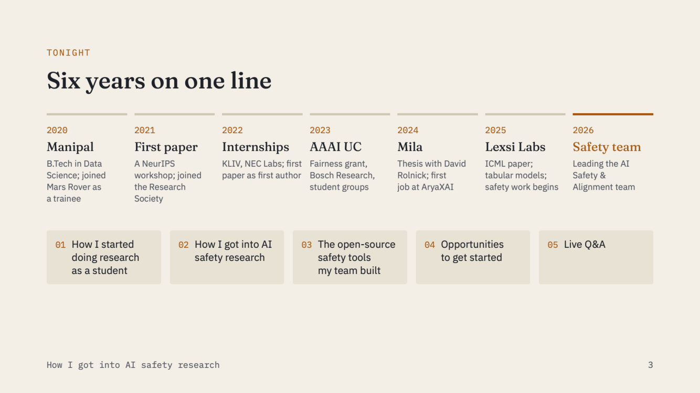
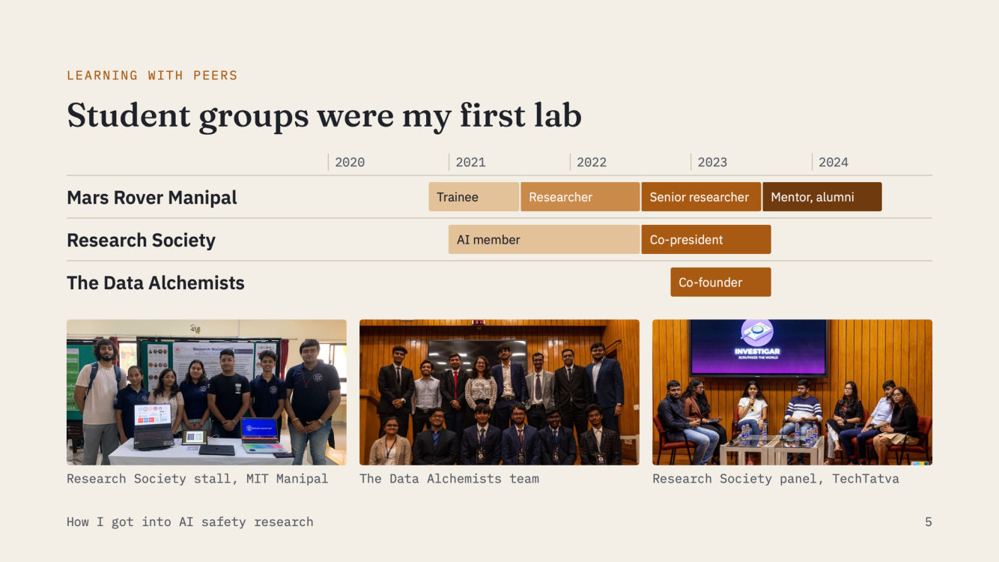
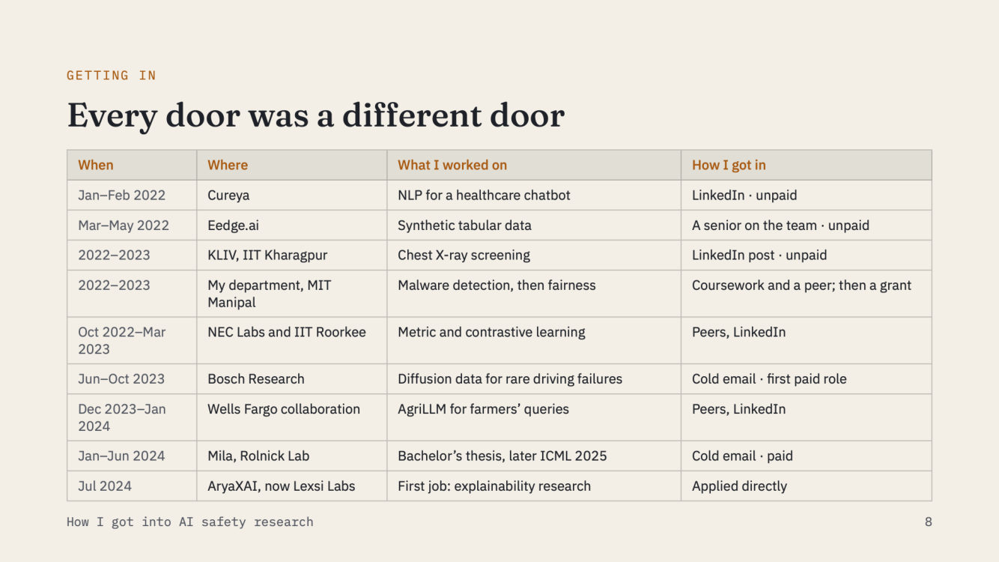
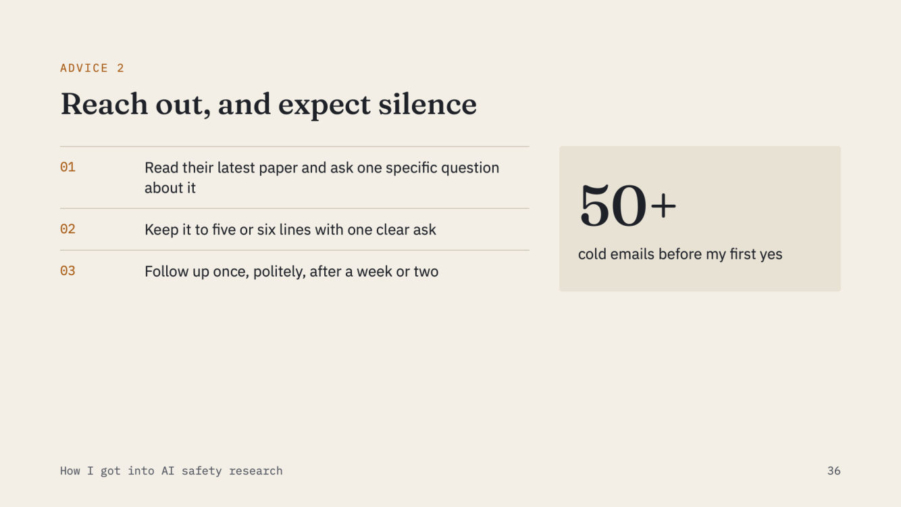
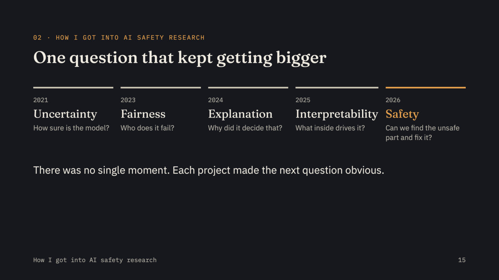
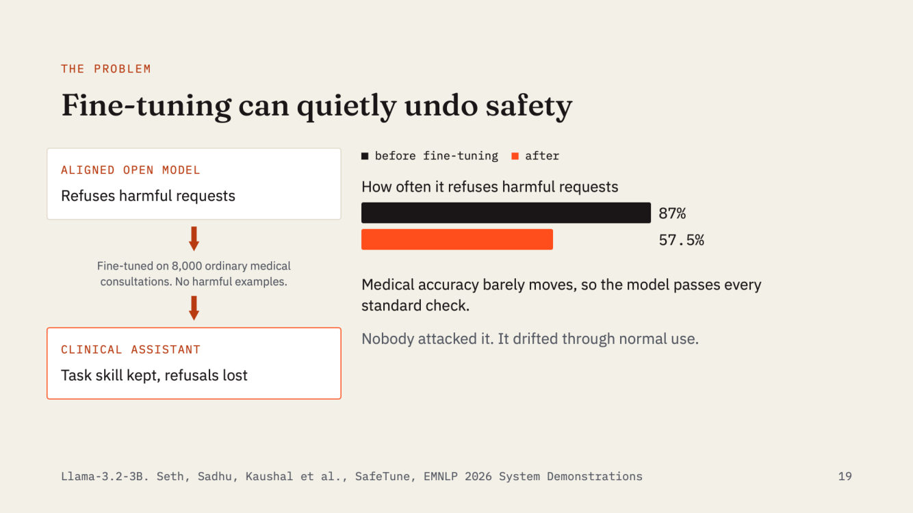
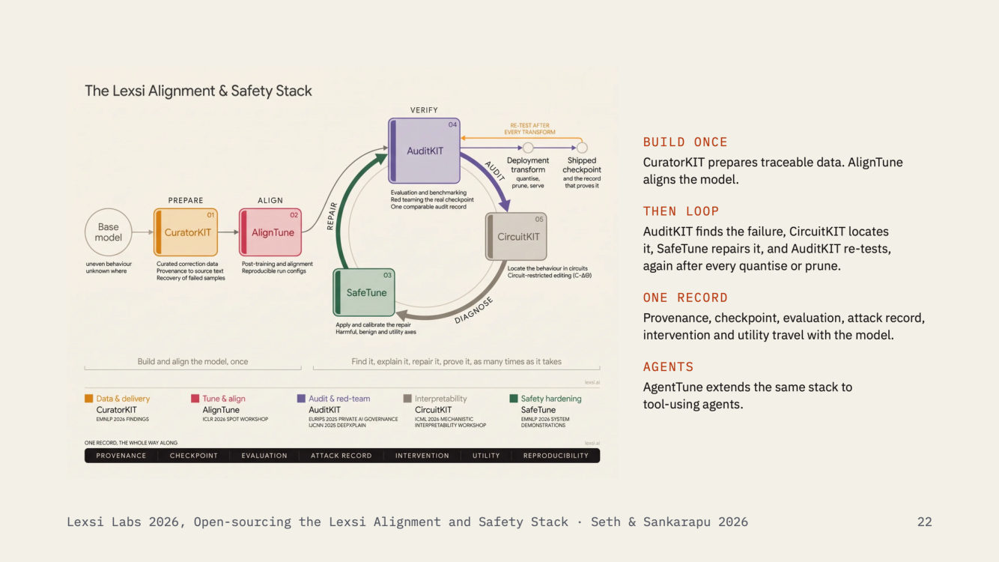
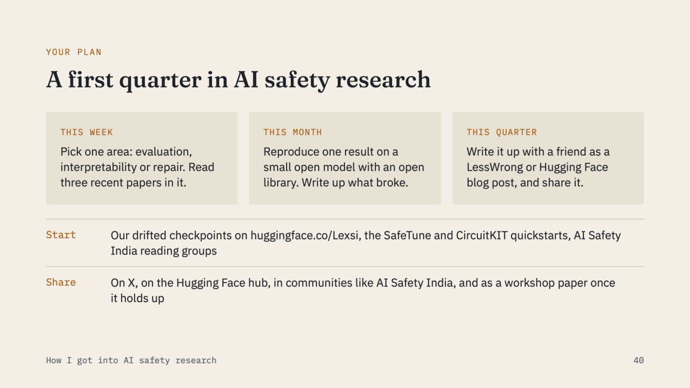

On 15 November 2026 I gave a spotlight talk at AI Safety India with this title. This is the written version, with the slides that carry the story. It has four parts: how I started doing research as a student, how I got into AI safety research, the open-source safety tools my team built, and how you can get started.

## Nobody in my family worked in tech

No one in my family worked in tech, and I didn't know anyone in research. In 2020 I started a B.Tech in Data Science & Engineering at Manipal Institute of Technology. What pulled me in was the data science major, the Mars Rover team, and a campus where students did research for fun. I joined Mars Rover Manipal as a trainee in my first year, before I knew what a paper was.

## Student groups were my first lab

I went from trainee to researcher to senior researcher at Mars Rover Manipal, and stayed on as a mentor. I joined the Research Society as an AI member and became its co-president, and I co-founded The Data Alchemists. The student teams I worked with published a steady stream of small papers: uncertainty under distribution shift at a NeurIPS workshop in 2021, contrails and diabetic retinopathy in 2022, thermal imaging, brain tumours and a SemEval shared task in 2023, and an AAAI student abstract and an EMNLP workshop paper in 2024.

I started small. The count of papers by year was 1 in 2021, 2 in 2022, 6 in 2023, 5 in 2024, 10 in 2025 and 20+ in 2026, of which 19 are accepted so far and 8 are as first author. All 14 of my papers from 2021 to 2024 were workshop papers, tiny papers, shared tasks, a student abstract or a preprint. The main conferences came after that. Many of mine were rejected at least once, and some still are.

## Every door was a different door

I got into each opportunity differently, and most of them were unpaid at first:

- A healthcare chatbot at Cureya, found on LinkedIn, unpaid.
- Synthetic tabular data at Eedge.ai, through a senior on the team, unpaid.
- Chest X-ray screening at KLIV, IIT Kharagpur, from a LinkedIn post, unpaid.
- Metric and contrastive learning with NEC Labs and IIT Roorkee, through peers and LinkedIn.
- Bosch Research in 2023, from a cold email: my first paid role.
- An AgriLLM collaboration with Wells Fargo, through peers and LinkedIn.
- Mila in 2024, in David Rolnick's lab, from a cold email, for my bachelor's thesis.
- AryaXAI in July 2024, now Lexsi Labs: my first job, where I applied directly.

Two of those cold emails mattered most. At Bosch I used diffusion models to generate the hard, misclassified examples that a self-driving perception model rarely sees. At Mila my thesis became the Alberta Wells Dataset for finding abandoned oil and gas wells from satellite images, published at ICML 2025. Both started as a short email to someone whose work I had read. It took more than 50 cold emails before my first yes.

In 2023 I was also one of 11 undergraduates selected worldwide as an AAAI Undergraduate Consortium Scholar, with a $2,000 travel grant to present at AAAI-23 in Washington, D.C. In 2026 I came back as a mentor.

## One question that kept getting bigger

There was no single moment when I decided to work on AI safety. Each project made the next question obvious.

In 2021 the question was uncertainty: how sure is the model? In 2023 it was fairness: who does it fail? One of those projects asked whether pre-training makes skin-lesion models work worse on darker skin tones, funded by a ₹10,000 undergraduate research grant and published at a WACV 2024 workshop with Dr Abhilash Pai. In 2024 it was explanation: why did it decide that? That one started at KLIV in 2022 and 2023, where I ran sanity checks on class activation maps and first asked whether an explanation can be trusted. In 2025 it was interpretability: what inside drives it? In 2026 it became safety: can we find the unsafe part and fix it?

At AryaXAI I worked on DL-Backtrace, a model-agnostic way to explain any network's decision, and xai_evals, a benchmark for checking whether explanations are any good. What I learned there is that explaining a model is not the same as fixing it. An explanation tells you why a model refused or misbehaved. It does not change what it does next time.

## From explaining models to fixing them

By July 2025 two things had come together. Inside the model, our pruning paper had used explanations to decide which neurons to cut, and if explanations can guide edits, they can guide safety fixes. From customers, interpretability alone wasn't enough: they needed to know a fine-tuned model was still safe, and to get a fix when it wasn't. Fine-tuning was becoming something any team can do, so safety drift would become everyone's problem. We started building the other pieces, evaluation, data and repair, and it became a team in April 2026.

The problem is easy to state. Take an aligned open model that refuses harmful requests and fine-tune it on 8,000 ordinary medical consultations, with no harmful examples. On Llama-3.2-3B, how often it refuses harmful requests fell from 87% to 57.5%, while medical accuracy barely moved, so the model passed every standard check. Nobody attacked it. It drifted through normal use.

Safety set once is not inherited by the next version. Domain training erodes refusal. Compressing a model to 4 bits can bring back up to 83% of the knowledge that unlearning removed. And in up to half of cases, a model's verdict stays the same when the law it cites is swapped for an unrelated one. A guardrail sees prompts and outputs, but the cause sits in the weights, so that is where we audit, correct and re-verify.

That is the open-source stack from the talk. You build once: CuratorKIT prepares traceable data and AlignTune aligns the model. Then you loop: AuditKIT finds the failure, CircuitKIT locates it, SafeTune repairs it, and AuditKIT re-tests, again after every quantise or prune. Provenance, checkpoint, evaluation, attack record, intervention and utility travel with the model as one record. AgentTune extends the same stack to tool-using agents. There is more on how it fits together on the [Experience page](/experience/#systems).

One result I would highlight is [C-ΔΘ](/publications/c-delta-theta/): on Gemma-3-4B, refusal of harmful crime prompts went from 35% to 91% while benign refusals stayed at 3%, whereas activation steering matched it only by refusing 68% of benign requests. And one warning: [The Off-Switch Failure](/publications/the-off-switch-failure/) shows that a model that has collapsed refuses everything, so a safety metric scores it as excellent. Always measure capability next to safety.

## What I would tell my student self

1. **Start small, and publish early.** A LessWrong or Hugging Face post, a workshop or tiny paper, a shared task. Short papers mean fast reviews and real feedback, and you meet the people in your field. Expect rejections.
2. **Reach out, and expect silence.** Read their latest paper, ask one specific question, keep it to five or six lines with one clear ask, and follow up once, politely.
3. **Find people at your level, and build together.** You don't need a famous lab to start. A few friends who read papers every week and finish projects together will take you further than waiting for permission.
4. **Evidence leads to opportunities.** A paper, a repository or a write-up is something a stranger can check in five minutes. Workshop papers and GitHub projects led to early internships, then Bosch Research and Mila, then my first job.

A first quarter looks like this. This week, pick one area, evaluation, interpretability or repair, and read three recent papers in it. This month, reproduce one result on a small open model with an open library, and write up what broke. This quarter, write it up with a friend as a blog post and share it, on X, on the Hugging Face hub, and in communities like AI Safety India.

Three open problems you can start on with a free GPU: whether a small open model refuses harmful requests in Hindi, Tamil or Bengali as well as in English; what happens to a 1B model's refusals when you fine-tune it on a harmless task; and re-running a published safety repair and reporting capability next to safety.

## Doors that are open to students in India

AI Safety India runs six-week cohorts in technical AI safety and AI governance, with 1:1 career advising and research sprints. SPAR, AI Safety Camp, BlueDot Impact courses and the Pathfinder Fellowship are other routes. The AAAI Undergraduate Consortium gives undergraduates with their own research proposal a mentor and travel support. Many IIT and IISc groups take remote interns and post openings on LinkedIn, which is how I found KLIV. And your own campus: a research society, a reading group or a rover team. If there isn't one, start it.

At Lexsi Labs there are research internships, open issues on our six libraries, and hackathons. Apply through [lexsi.ai](https://lexsi.ai) under Careers. If you want mentorship or to work on something together, [write to me](/#contact).

## Thank you

None of this was solo work: 70 co-authors across my papers, 12 mentors in labs and internships, and two advisors at AryaXAI and Lexsi Labs. Thank you to the people who took a chance on a student: Ujjwal Verma, Debdoot Sheet, Rakshith Satish, Abhilash Pai, Vidya Rao, Poornima P.K., Ananta Mahapatra, Vijay Kumar B.R., Koustav Mullick, Amit Kale, Amit Agarwal, David Rolnick, Vinay Kumar Sankarapu and Chintan Chitroda, and everyone at Mars Rover Manipal, the Research Society, The Data Alchemists, AryaXAI and Lexsi Labs.
